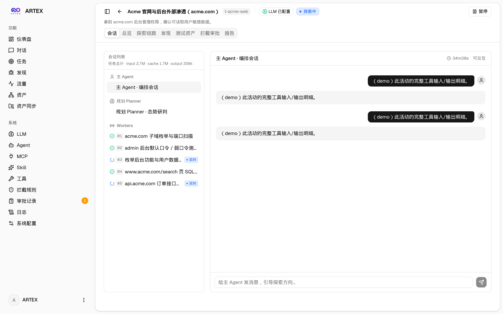
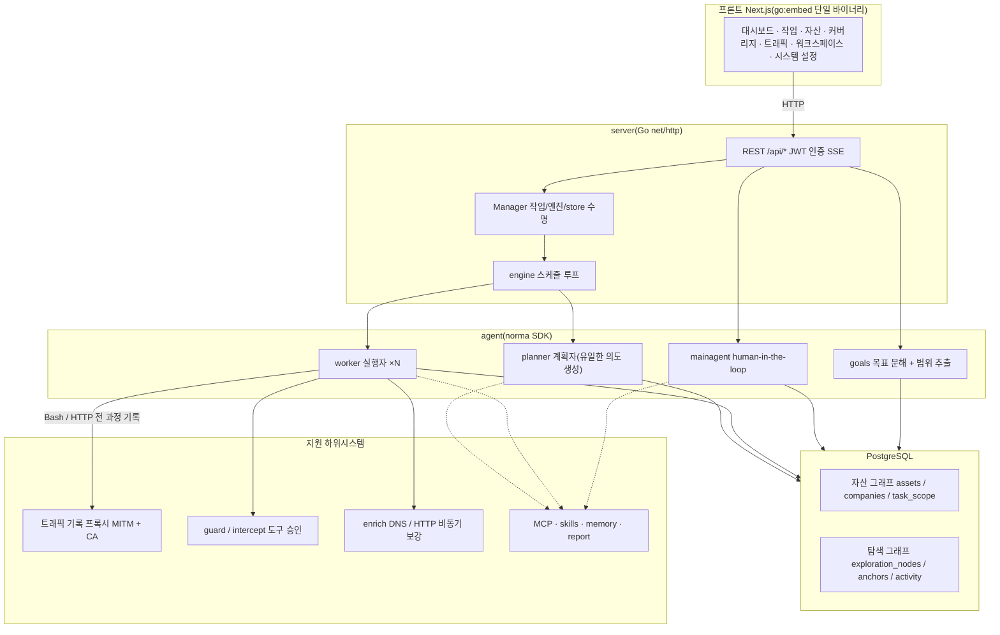
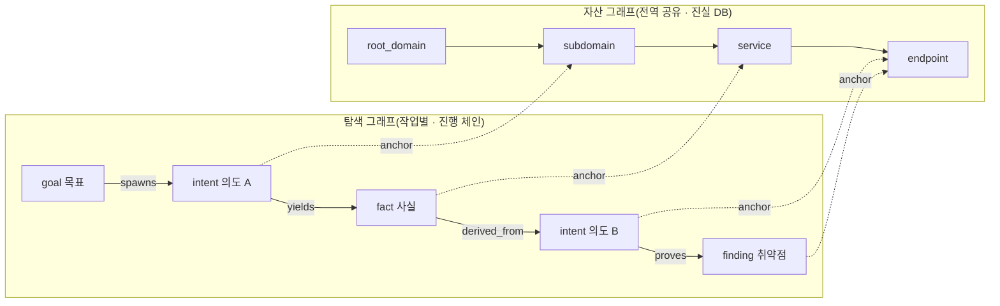
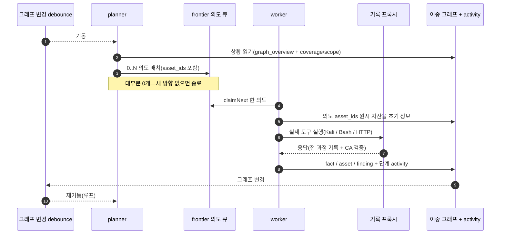
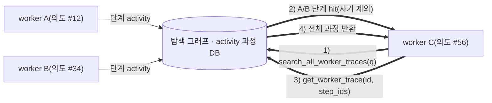
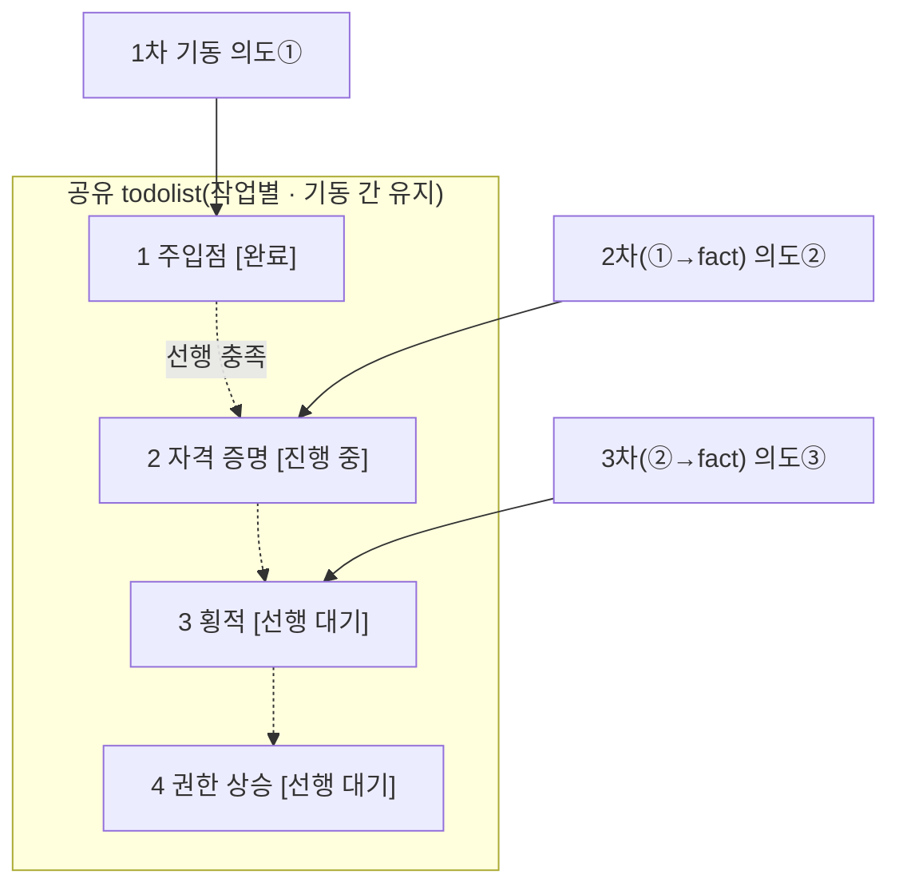

<div align="center">

# ARTEX

AI 자율 침투 테스트 시스템(Go 백엔드 + Next.js 프론트엔드)


🌐 **온라인 Demo**: [https://artex-demo.vercel.app/](https://artex-demo.vercel.app/)

</div>

---

## 스크린샷 미리보기

> 전체 상호작용은 [온라인 Demo](https://artex-demo.vercel.app/)에서 확인하세요.

| 대시보드(개요 / Token 소비 / 활동 스트림) | 작업 목록 |
| :---: | :---: |
|  |  |

| 작업 · 실행 과정(세션 / 도구 호출) | 탐색 링크 |
| :---: | :---: |
|  |  |

| 발견 | 자산 |
| :---: | :---: |
|  |  |

| 자산 커버리지 그래프(포스 레이아웃 · 테스트 완료 강조 · 노드 접기/펼치기) |
| :---: |
|  |

| 트래픽 녹화 | Human-in-the-loop 대화 |
| :---: | :---: |
|  |  |

| Agent 관리 | LLM 설정 |
| :---: | :---: |
|  |  |

| 인터셉트 승인 | 백엔드 로그 |
| :---: | :---: |
|  |  |


---

## 승인 기록 상세

전역 「승인 기록」, 작업 내 「인터셉트 승인」, 대화의 승인 카드 모두 펼쳐 상세를 볼 수 있습니다. 표시 구조는
[AegisHook 승인 상세 컴포넌트](https://github.com/RuoJi6/AegisHook/blob/main/web/src/components/CallDetail.vue)를 참고하며, ARTEX 컴포넌트와 테마를 따릅니다.


## 자산 동기화(ScopeSentry)

[ScopeSentry](https://github.com/Autumn-27/ScopeSentry)에서 자산 데이터를 직접 동기화해 중복 수집을 줄입니다:

- 「**자산 동기화**」 페이지에 ScopeSentry 주소와 API Key를 입력해 데이터 소스 연결;
- **프로젝트** 또는 **작업** 단위로 동기화 대상·자산 유형(도메인 / 서브도메인 / IP / 포트 / 사이트 / 엔드포인트…) 선택;
- 원클릭 가져오기 후 회사 자산 범위로 병합, ARTEX 자산 그래프에 바로 반영해 agent 탐색에 사용.

---

## 설치

> 데이터베이스 **PostgreSQL** 필요; 탐색에는 **LLM** 설정 필요(`ANTHROPIC_API_KEY` 또는 `OPENAI_API_KEY`, UI에서도 설정 가능).

### 방법 1: 원클릭 설치 스크립트(권장)

```bash
git clone https://github.com/Autumn-27/ARTEX.git
cd ARTEX
./install.sh
```

스크립트: Docker 감지/자동 설치 → **① 전체 Docker** 또는 **② 로컬 빌드 실행** 선택:

- **① 전체 Docker**: Postgres 비밀번호 입력(Enter 시 랜덤) → `.env` 자동 작성 → `docker compose up -d`.
- **② 로컬 실행**: DB 선택(기존 연결 / Docker로 기동) → `config.json` 생성 → `go`로 프론트 내장 단일 바이너리 빌드 → 시작.

설치 후 **http://localhost:8787** 접속(최초 `/setup`에서 관리자 비밀번호 설정).

### 방법 2: Docker Compose(수동)

```bash
git clone https://github.com/Autumn-27/ARTEX.git
cd ARTEX
cp .env.example .env          # POSTGRES_PASSWORD, 선택 ANTHROPIC_API_KEY
docker compose up -d --build  # 이 저장소에서 한국어 UI 이미지 빌드 + postgres
# → http://localhost:8787  (최초 /setup)
```

첫 실행·UI/코드 변경 후에는 `--build`로 `artex` 이미지를 다시 빌드하세요. 이후 이미지가 있으면 `docker compose up -d`만으로도 됩니다.

런타임 이미지에 ripgrep/curl/vim/npm/nmap 등 포함; `./skills`와 `./data`는 bind mount로 영속화. 공식 `autumn27/artex` Hub 이미지는 사용하지 않습니다.

원격 MCP는 시스템 설정에서 `http`(Streamable HTTP) 또는 `sse`(구버전 SSE) 선택.
구 SSE는 보통 `GET /sse`로 이벤트 스트림, 서비스가 반환하는
`/message?sessionId=...`로 JSON-RPC 수신; URL은 `/sse`, 헤더는
`Authorization=Bearer <token>`.

### 방법 3: 사전 빌드 바이너리 다운로드(Releases)

[Releases](https://github.com/Autumn-27/ARTEX/releases)에서 플랫폼 zip 다운로드, 압축 해제 후 `artex` + `start.sh`(Windows `start.bat`) + `skills/` + `config.example.json`:

```bash
cp config.example.json config.json   # database 연결 설정
./start.sh                           # → http://localhost:8787
```

> `./artex` 직접 실행 대신 `start.sh` / `start.bat` 사용. 감시 스크립트로 종료 코드에 따라 재기동하며, **[페이지 원클릭 업데이트](#방법-1-페이지-원클릭-업데이트-권장)**가 이를 통해 바이너리 교체합니다. `./artex`만 실행하면 업데이트 후 재기동되지 않습니다.
> 백그라운드: `nohup ./start.sh >artex.log 2>&1 &`.

### 방법 4: 소스에서 단일 바이너리 빌드

```bash
# 1) 프론트 정적 export
cd web && npm ci && npm run build:static && cd ..
# 2) 내장 디렉터리로 복사
cp -r web/out server/webui/dist
# 3) 빌드(-tags embedui 시 프론트 내장)
CGO_ENABLED=0 go build -tags embedui -o artex ./cmd/artex
./start.sh
```

### 방법 5: 크로스 플랫폼 Release zip 빌드

`build.sh`는 프론트 빌드·내장 후 Go linker로 디버그 정보 제거·zip 압축. Release 모드 기본: Linux amd64/arm64, macOS amd64/arm64, Windows amd64 zip:

```bash
./build.sh --release
# 결과: dist/artex-0.3.3-*.zip
```

UPX 자해제 바이너리는 일부 Linux 커널·가상화·보안 정책과 호환되지 않을 수 있어 기본 비활성. `ARTEX_TARGETS`로 대상 지정; 환경 호환 확인 시 `--upx`로 크기 축소:

```bash
ARTEX_TARGETS=linux/amd64,windows/amd64 ./build.sh --release
./build.sh --target linux/amd64 --upx
```

---

## 업데이트

> 업데이트는 프로그램만 교체·데이터 유지: Postgres 볼륨 `pgdata`, `./data`(jwt.key / SQLite 등), `./skills` 보존. **DB 마이그레이션 수동 불필요**—`artex` 시작마다 `schema.sql` 멱등 재실행(`ADD COLUMN` / `CREATE INDEX IF NOT EXISTS`), 즉 재시작 시 마이그레이션. 업그레이드 전 `./data`와 DB 백업 권장.

### 방법 1: 페이지 원클릭 업데이트(권장)

**시스템 설정** 페이지(사이드바 「시스템 설정」→ `/system/settings`) **버전 및 업데이트** 카드에서 새 버전 확인·설치, 서버 SSH 불필요.

「업데이트」 후: 현재 플랫폼 릴리스 다운로드 → Release `SHA256SUMS` 검증 → `-h`로 새 바이너리 스모크 테스트 → `artex.new`로 스테이징 → 프로세스 종료, `start.sh` / `start.bat`가 재기동·교체. 페이지는 새 버전 올라온 뒤 자동 새로고침.

- **실패 시 불량 바이너리 없음**: 검증·스모크 실패 시 스테이징 삭제·현재 버전 유지; 교체 후 새 버전 연속 3회 기동 실패 시 `artex.old`로 자동 롤백(실패본은 `artex.failed`로 보관).
- **언제든 롤백**: 이전 버전 `artex.old` 보관, 카드에 「이전 버전으로 롤백」. DB 스키마는 롤백되지 않음.
- **업데이트는 실행 중 작업 중단**—재시작이므로 여유 시 수행.
- **개발 빌드는 업데이트 비활성**: 버전 `dev` 또는 `git describe` 접미사 시 비활성, 릴리스가 로컬 디버그 바이너리 덮어쓰기 방지.
- **Docker는 프로그램만·이미지 아님**: 이미지 내 playwright/nmap 등은 따라오지 않고 `docker compose up -d` 재생성 시 이미지 기본 버전으로 복귀. 이미지까지는 `docker compose pull artex && docker compose up -d artex`.
- GitHub 프록시 필요 시 같은 페이지 **전역 프록시** 설정, 업데이트 경로가 사용. GitHub 도메인만·HTTPS 강제.

### 방법 2: 원클릭 업데이트 스크립트

```bash
cd ARTEX
./update.sh
```

선택 `git pull` 후 **① Docker 업데이트** 또는 **② 로컬 빌드 업데이트**(`install.sh`에 대응):

- **① Docker**: 이미지 tag 지정(Enter 시 `.env` `ARTEX_TAG`, 기본 `latest`) → `docker compose pull` → `docker compose up -d`(새 이미지 재시작·자동 마이그레이션).
- **② 로컬**: 프론트 정적 재빌드 → `./artex` 재컴파일(재시작 후 적용).

### 방법 3: Docker Compose(수동)

```bash
cd ARTEX
git pull                       # compose/스크립트 갱신(선택)
# 버전: .env에 ARTEX_TAG=v0.2.0; 없으면 latest
docker compose pull artex
docker compose up -d artex     # 새 이미지 재시작 → schema 자동 마이그레이션
docker image prune -f          # 구 이미지 정리(선택)
```

### 방법 4: 사전 빌드 바이너리(Releases)

[Releases](https://github.com/Autumn-27/ARTEX/releases)에서 새 zip, 구 프로세스 종료 후 `artex`·`skills/` 덮어쓰기(`config.json`·`data/` 유지), 재시작:

```bash
cp -r <解压目录>/skills ./ && cp <解压目录>/artex ./
./start.sh
```

### 방법 5: 소스 빌드

```bash
git pull
cd web && npm ci && npm run build:static && cd ..
cp -r web/out server/webui/dist
CGO_ENABLED=0 go build -tags embedui -o artex ./cmd/artex
# ./start.sh 재시작
```

---

## 설정

**데이터베이스**(`config.json`, 환경 변수 `ARTEX_PG_DSN`으로 덮어쓰기 가능):

```json
{
  "database": {
    "host": "127.0.0.1", "port": 5432,
    "user": "artex", "password": "yourpass",
    "dbname": "artex", "sslmode": "disable"
  }
}
```

**LLM**: `export ANTHROPIC_API_KEY=sk-...`(또는 `OPENAI_API_KEY`), UI 「LLM 설정」에서도 입력.
선택: `ARTEX_LLM_PROVIDER` / `ARTEX_LLM_MODEL` / `ARTEX_LLM_BASE_URL` / `ARTEX_LLM_PROXY`.

**동시성**: 작업당 work agent 수는 「시스템 설정」(기본 3).

**자주 쓰는 인자**: `./start.sh -addr :8787 -proxy :8788`(`-addr` 프론트+API, `-proxy` 트래픽 녹화 프록시). 시작 스크립트가 인자를 `artex`에 전달.

### 리버스 프록시 배포(HTTPS / 443만 개방)

프론트·API/SSE는 동일 백엔드 포트(기본 `:8787`)에서 제공, 실시간 활동 스트림은 기본 **동일 출처**이므로 **`NEXT_PUBLIC_SSE_BASE` 불필요**, 공인 443만 열고 8787은 내부에 두면 됨.

SSE는 장연결·지속 푸시, 역프록시는 **버퍼링 비활성** 필수, 그렇지 않으면 연결은 되나 이벤트 없음(활동 스트림 로딩만). Nginx 예:

```nginx
server {
    listen 443 ssl;
    server_name your.domain.com;
    # ssl_certificate / ssl_certificate_key ...

    location / {
        proxy_pass http://127.0.0.1:8787;
        proxy_set_header Host $host;
        proxy_set_header X-Forwarded-Proto $scheme;

        # SSE 핵심: 버퍼링 off, 긴 타임아웃, HTTP/1.1
        proxy_buffering off;
        proxy_cache off;
        proxy_read_timeout 3600s;
        proxy_http_version 1.1;
        proxy_set_header Connection "";
    }
}
```

> SSE가 페이지와 다른 출처(별도 서브도메인 등)일 때만 **빌드 시** `NEXT_PUBLIC_SSE_BASE` 설정(`next build` 시 정적 패키지에 고정, 컨테이너 실행 시 설정 무효).

---


## 개발

### 수동 취약점 재검증

작업 상세 「재검증」 탭에서 해당 작업 취약점 페이지 선택, 과거 결론·증거 조회, 수동 재검증 시작. 시작 후 현재 탭 유지, 스피너와 「재검증 중」; 수정 확인 시 취약점 상태 동기 갱신.

취약점 목록 행 「재검증」, 또는 상세 「취약점 재검증」에서 「재검증 시작」, 선택적 수정 버전·테스트 조건·제한 입력 시 독립 재검증 Agent 세션 생성, 현재 페이지 유지. 평면·작업별·자산 뷰 모두 동일 진입; 실행 중 스피너·「재검증 중」, 세션 보기는 해당 세션으로, 종료 후 「재검증」 복귀. 원 스캔 작업 재시작 불필요, 결론 「여전히 재현」「수정됨」「확인 불가」, 각 결론·증거·세션 링크는 취약점 상세에 저장.

신규 백엔드 최초 기동 시 편집 가능 「취약점 재검증」(`retester`) Agent 사전 배치, Agent 관리에서 프롬프트·LLM·실행 예산·도구 설정. 기본은 바인딩 LLM, 없으면 전역 활성 설정. 재검증 세션 성공·결론 「수정됨」이면 자동으로 취약점 처리 상태 「수정됨」; 실행 중·실패·중지·기타 결론은 원 상태. 원본 증거·보고서 유지. 상태 드롭다운에서 수동 「수정됨」 가능. 동일 취약점 재검증 중이면 기존 세션 재사용, 중지·실패·서비스 재시작 후 재시작 가능.

이번 버전 이력은 취약점 상세·세션으로만 조회, 보고서 export·작업 아카이브·트래픽 자동 연결은 미포함. 데모 모드는 명시적 모의 기록만, 실제 대상 요청 없음.

### 로컬 실행 및 테스트

```bash
./dev.sh    # 백엔드(:8787) + 트래픽 프록시(:8788) + 프론트 next dev(:5173) → http://localhost:5173
```

- 백엔드: `go run ./cmd/artex`(`-tags embedui` 없으면 프론트 미내장)
- 프론트: `cd web && npm run dev`(`/api` 백엔드 프록시, HMR)
- 테스트: `go test ./...`
- Mock 미리보기(백엔드 없음): `cd web && NEXT_PUBLIC_MOCK=1 npm run dev`

---

## 시스템 기술 아키텍처

ARTEX는 **LLM 다중 agent 기반 자율 침투 시스템**: Go 모놀리식 백엔드(Next.js 프론트 내장) + PostgreSQL, agent는 [`norma`](https://github.com/Autumn-27/norma) SDK(`agentcore` / `tool` / `permission` / `harness` / `memory` / `transcript`). 핵심은 **이중 그래프**와 **worker 간 과정 수준 정보 교환**, **planner 다회차 공유 todolist로 안정적 공격 체인**.

### 전체 레이어



| 레이어 | 역할 |
| --- | --- |
| **프론트** | Next.js 정적 export, `go:embed` 단일 바이너리; 작업/자산/탐색 링크/커버리지 시각화, human-in-the-loop 대화 |
| **server** | `net/http` 라우팅 + JWT + SSE; `Manager`가 작업·엔진·DB store 수명 관리 |
| **engine** | 작업당 `plannerLoop` + N worker goroutine; 의도 claim, 타임아웃/일시정지/drain |
| **agent** | goals / planner / worker / mainagent, `ToolSet`이 이중 그래프를 LLM 도구로 노출 |
| **db** | 이중 그래프 Postgres(pgx); schema `go:embed`로 시작마다 멱등 생성 |
| **지원** | 기록형 MITM 프록시, 승인 게이트, 비동기 보강, MCP/스킬/메모리/보고 |

### 이중 그래프: 탐색 그래프 + 자산 그래프

「**목표가 무엇인지**」와 「**어디까지 테스트했는지**」를 독립적이나 앵커로 연결된 두 그래프로 분리:

- **자산 그래프(Asset Graph, 전역 공유)**: 작업 간 공유 자산 단일 진실. 노드 `root_domain / subdomain / ip / service / app / endpoint`, 회사 소속; 도메인→서브도메인→서비스→엔드포인트 관계·중복 key는 프로그램 계산, agent는 원시 정보만 제출.
- **탐색 그래프(Exploration Graph, 작업별)**: 한 작업의 사고·진행. 노드 `goal / intent / fact / finding / hint`, `spawns / derived_from / yields / proves` 등으로 **혈연 체인**, 「어떤 방향이 어떤 사실에서 파생·무엇을 냈는지」.
- **앵커로 연결**: `exploration_anchors(node_id, asset_id)`가 의도/사실/취약점을 자산에 고정—탐색 방향→대상 자산, 자산→이 작업에서 어떤 의도·사실이 있었는지 역조회. **자산 테스트 커버리지**·**커버리지 그래프**(범위 내 자산 + 테스트 완료 강조) 지원.



> 역할: **planner**는 탐색 그래프 상황·목표 판단, 미커버 새 방향 있을 때만 **의도**를 frontier에; **worker**는 **한 의도** claim, 실제 도구 실행, 새 자산/사실/취약점을 두 그래프에 쓰고 종료. 자산 그래프는 공유 사실, 탐색 그래프는 작업별 진행 체인.

### 엔진과 의도 수명주기(한 번의 탐색 루프)

엔진은 **이벤트 기반** 루프: 그래프 변경→planner 기동, planner가 의도 배치, worker claim·실행·기록, 기록이 다음 라운드—목표 `prove_goal`까지.



### worker 간 과정 수준 정보 교환

깊은 탐색에서 유의한 관찰(오류, 응답 일부, hidden 파라미터)은 한 worker **실행 과정**에만 있고 formal fact가 아닐 수 있음. 중복을 줄이고 체인 상의 worker가 서로의 결과를 쓰도록 **cross-work 과정 검색**:

- `search_all_worker_traces(q)`: **같은 작업 다른 work 실행 과정**에서 키워드 검색(자기 의도 단계 제외), hit에 `intent_id`;
- `list_worker_traces` / `get_worker_trace(intent_id, step_ids=[…])`: 어떤 work가 있었는지 본 뒤 특정 단계 전체 내용 교환.

탐색 그래프에 fact가 없어도 후속 worker가 과정 관찰 재사용—**정보는 worker 간 「실행 과정」 단위로 흐름**, 각 worker는 여전히 자신의 한 의도만 수행.



### planner 다회차 공유 todolist → 안정적 공격 체인

실제 공격 체인은 **순차 의존 다단계**(주입점 → 자격 증명 → 횡적 → 권한 상승)이며, 한꺼번에 병렬 배치하면 혼란. planner는 **작업별·기동 간 공유 todolist**를 유지:

- planner는 이벤트 기반—그래프 변경마다 기동, **각 기동은 새 세션**; 공유 todolist로 직렬 체인을 **한 번 기록**하고 이후 **의존 순으로 의도 배치**, 한 라운드에 전체 전개하지 않음;
- 매 라운드 「선행 완료·의존 fact 존재」한 다음 단계만 의도 배치, 진행에 따라 완료 표시.



이벤트 기반·무상태 세션에서도 공격 체인이 **안정·비중복·순서 유지**—ARTEX가 다단계 exploit을 자율 완료하는 핵심.

---

## 커뮤니티

WeChat 공식 계정 **SecSentry** QR 스캔 후 계정 메시지로 그룹 참여.

<div align="center">


</div>

---
## 참고

https://github.com/oritera/Cairn


## 라이선스 및 면책

### 오픈소스 라이선스

본 프로젝트는 **GNU Affero General Public License v3.0(AGPL-3.0)** 하에 배포되며, 전체 조항은 저장소 루트 [LICENSE](LICENSE)를 참고하세요.

누구나 자유롭게 사용·수정·배포할 수 있으나, **파생 저작물도 동일하게 AGPL-3.0으로 공개**해야 합니다. 특히 **본 프로젝트를 수정해 네트워크(예: 온라인 서비스)로 사용자에게 제공하는 경우, 해당 사용자에게 완전한 해당 소스코드를 공개**해야 합니다.

> ⚠️ **중요**: 오픈소스 라이선스 자체는 사용 목적을 제한하지 않습니다. 아래 「사용 제한」과 「면책」은 저작자가 사용자에게 하는 추가 약정·중대한 고지이며 반드시 준수하세요.

**ARTEX는 개인 학습, 코드 연구, 로컬 기술 검증용으로만 사용하며, 어떠한 온라인 시스템·웹사이트에 대한 실제 테스트에도 사용할 수 없습니다.**

### 허용 사용 범위

- **본 프로젝트 소스 읽기·학습·연구** 및 **로컬 격리 환경**에서의 기술 원리 검증만;
- 개인 학습, 학술 연구, 코드 리뷰 등 비공격적 목적.

### 금지 사항

- **본 도구로 웹사이트·온라인 서비스·연결된 시스템에 스캔·탐지·이용·공격 금지**(승인 여부·자산 소유와 무관);
- 실제 침투 테스트, 공방, 프로덕션 환경 사용 금지;
- 불법 침입, 데이터 탈취, 랜섬, DoS 등 파괴·범죄 활동 금지;
- 거주 지역 법률 위반 행위 금지.

### 규정 준수 책임

사용자는 거주 지역의 네트워크 보안·데이터 보호·컴퓨터 범죄 관련 법률을 스스로 준수해야 합니다(중국 본토에서는 《网络安全法》《数据安全法》《个人信息保护法》 및 관련 해석 등). **본 도구 사용으로 발생하는 모든 법적 책임·결과는 사용자 본인에게 있습니다.**

### 면책 조항

본 프로젝트는 「있는 그대로(AS IS)」 제공되며 명시·묵시적 보증 없음. 저작자·기여자는 사용 방식과 관계없이 본 도구 사용으로 인한 직·간접 손실, 데이터 손실, 시스템 손상, 법적 분쟁에 책임지지 않습니다. **다운로드·설치·사용 시 위 전체 조항을 읽고 이해·동의한 것으로 봅니다.**
