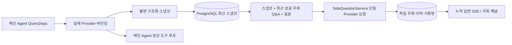

# ARTEX `/btw`

일반 채팅, 작업 MainAgent, 현재 작업의 Worker가 각각 독립적인 우회 질문을 지원합니다. 메인 입력창에 `/btw 질문`을 입력해 제출하고, 빈 `/btw` 또는 「우회 질문」 버튼으로 이력을 엽니다. 데스크톱은 너비 조절 가능한 사이드바, 모바일은 Drawer를 사용합니다.

우회 답변은 제출 시점의 Agent 컨텍스트 스냅샷으로 생성되며, 스트리밍 표시·추가 질문·중지·비우기를 지원합니다. 패널 닫기, 페이지 새로고침, SSE 끊김은 모델 요청을 취소하지 않습니다. 중지는 현재 우회만 영향; 비우기는 우회를 취소하고 우회 이력을 삭제하며, 메인 컨텍스트 스냅샷은 유지합니다.

## 구현 경계

Go, norma v0.3.7, Next.js, 기존 Markdown / ResizablePanel / Drawer / AlertDialog 컴포넌트를 따릅니다. norma 소스나 우회용 의존성은 추가하지 않았습니다. Planner, 다른 작업에서 상속한 Worker, 도구형 하위 작업 승격은 이번 범위 밖입니다.

- `capture.go`는 `Options.Deps.CallModel / CallModelSync`만 메인 루프 요청으로 표시합니다. Provider 데코레이터는 구체 모델 내부, 라우팅 풀 외부 선택 이후에 있어 실제 선택된 모델을 기록합니다. 압축·요약 요청은 스냅샷을 덮어쓰지 않습니다.
- 요청 시작, 완전한 모델 응답, 실행 종료 시 스냅샷을 게시합니다. 생성 중인 반쪽 응답은 게시하지 않습니다. 도구 호출은 norma `MessagesForAPI`로 쌍을 유지하고, 도구 결과는 다음 메인 모델 요청 또는 실행 종료 시 스냅샷에 들어갑니다. 스트리밍 중단은 마지막 유효 경계를 유지합니다.
- 스냅샷은 JSON 깊은 복사로 구조화 메시지, 시스템 프롬프트, 도구 정의, 생성 파라미터를 보존합니다. 모델 추론은 스냅샷 잠금·DB 트랜잭션을 보유하지 않습니다.
- `SideQuestionService`는 구체 Provider를 호출합니다. 필요 시 우회 요약을 먼저 생성하고, 최종 답변은 첫 컨텍스트 초과이며 아직 텍스트/도구 호출이 없을 때만 축소 후 최대 1회 재시도합니다. agent session을 만들지 않고, 도구 실행기·메인 transcript·활동 스트림·작업 그래프·작업 모델 전환 체인에 연결하지 않습니다. 답변에 도구 정의를 남기는 것은 기존 구조화 도구 컨텍스트 호환용이며, 요약 요청에는 도구를 제공하지 않습니다. 새로 반환된 도구 호출은 실행 경로가 없습니다.
- 부모 세션당 하나의 실행 요청, 서비스 프로세스당 최대 4개, 단일 타임아웃 120초. 우회는 서비스 수명의 독립 취소 컨텍스트를 사용합니다.
- 우회 요청은 모델 설정 참조와 비민감 신원 요약을 유지합니다. 요청 시 기존 설정에서 자격 증명을 가져옵니다. 설정 삭제 또는 모델·프로토콜·주소 등 신원 필드 변경 시 먼저 메인 Agent를 실행해 스냅샷을 갱신해야 합니다. 테스트는 제품 기본 모델을 바꾸지 않습니다.

## 영속화 및 복구

`db/schema.sql`이 `side_question_sessions`와 `side_question_requests`를 자동 생성합니다. 전자는 부모 리소스, 최신 스냅샷, 실행 번호, 버전, 정리 버전을 저장하고, 후자는 질문, 누적 답변, 상태, 모델, 스냅샷 시각, 사용량, 이벤트 순번, 페이지 순번을 저장합니다.

부모 세션 키는 conversation ID 또는 task ID + exploration ID + intent ID입니다. Worker는 재사용 가능한 실행 슬롯 이름을 쓰지 않습니다.

스냅샷은 부모 세션별 병합 쓰기, 250ms마다 갱신, DB에서 `(run_id, version)` 비교로 구 버전 덮어쓰기 방지. 우회 제출 전 선택 스냅샷을 다시 저장합니다. 성공 저장 후 메모리의 큰 스냅샷 해제; 실패 시 대기 버전 유지. 답변 누적은 스트리밍 이벤트마다 최대 250ms마다 쓰고, 종료 시 즉시 저장·DB 오류 시 제한 재시도.

서비스 시작 시 남은 `running` 요청을 `interrupted`로 표시하고, DB에 저장된 부분 답변·사용량은 유지하며 요청을 자동 재생하지 않습니다. 최근 성공 저장 컨텍스트로 다음 질문 가능. 구 세션에 스냅샷 없으면 먼저 메인 Agent 실행 필요, UI 활동 기록으로 재구성하지 않음.

비우기는 정리 버전을 올리고 요청을 삭제합니다. 조건부 갱신으로 늦은 콜백 재쓰기 방지. 물리 부모 삭제는 FK CASCADE, Worker 논리 삭제는 같은 트랜잭션에서 우회 데이터 삭제·늦은 스냅샷 거부. 작업 아카이브는 새 요청 차단·메인 흐름 정지 대기·우회 취소·대기 후 아카이브; 형식 v3, 우회 테이블 없는 v1/v2 호환.

이력 전체 저장, 순번 커서로 페이지당 최대 20건. 모델 요청은 최근 성공 Q&A 원문 최대 20쌍 재생, token 예산으로 재생량 제한; 더 오래된 Q&A는 독립 롤링 요약. 메인 컨텍스트 예산 초과 시 우회 복사본의 오래된 부분만 요약, 최근 구조화 도구 호출·결과는 최대 8K tokens 유지. 요약·준비 진행·사용량은 우회 동시성·취소·120초 타임아웃에 포함. 자세한 내용은 [컨텍스트 예산 및 오픈소스 참고](CONTEXT_BUDGET.md).

## HTTP 계약

다음 경로를 `{parent}`로, 기존 인증·리소스 검증 유지:

- `/api/conversations/{id}`
- `/api/tasks/{id}/chat`
- `/api/tasks/{id}/intents/{iid}`

| 요청 | 반환 및 동작 |
| --- | --- |
| `GET {parent}/side-questions?before={ordinal}` | `items` 최신순, 독립 `current` 실행 상태, `snapshot` 메타, `next_cursor`; 커서 0은 최신 페이지/다음 페이지 없음 |
| `POST {parent}/side-questions` | JSON `{ "question": "…", "client_request_id": "UUID" }`; 새 요청 202 및 요청 객체; 동일 ID·질문이면 기존 객체 200 |
| `DELETE {parent}/side-questions` | 현재 부모 세션 우회 Q&A 취소·비우기 |
| `GET /api/side-questions/{requestID}/events` | `snapshot` SSE 이벤트, `id` 증가 순번, `data`는 전체 누적 요청 객체; 비울 때 `cleared` |
| `POST /api/side-questions/{requestID}/cancel` | 명시 취소; 종료 상태는 이력 또는 SSE |

질문 상한 4000자. 스냅샷 없음, 모델 설정 변경, 동일 부모 바쁨, 멱등 ID 충돌은 409; 전역 동시 상한 429. SSE 연결마다 먼저 누적 상태 전송, 클라이언트가 이전 텍스트 조각을 받았다고 가정하지 않음. 프론트는 요청 ID + 순번 병합, 부모 전환·비울 때 구 콜백 폐기.

## 검증 및 참고

자동 검사, 실제 모델 사용, 알려진 제한은 [VALIDATION.md](VALIDATION.md).

독립 요청 참고 [Grok CLI side-question.ts (고정 커밋)](https://github.com/superagent-ai/grok-cli/blob/fb97af83f06dca873281d60168430f06c8de6324/src/utils/side-question.ts), 실행 격리 참고 [OpenCode (고정 커밋)](https://github.com/anomalyco/opencode/tree/b3f1a96c6dd7adeb28b36dd11add1998fc84d67b). ARTEX 컨텍스트는 norma 구조화 메시지를 사용하며, 프론트 로그 텍스트를 이어 붙이는 방식은 쓰지 않습니다.
